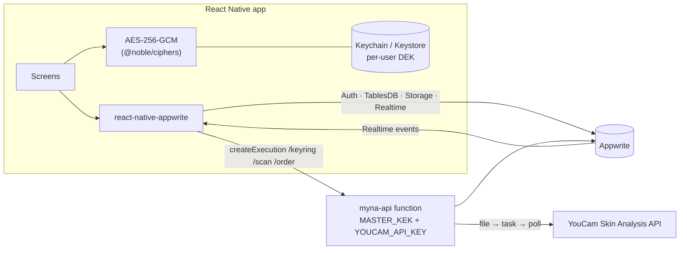

# myna features

Everything the app does today. To get it running, see [SETUP.md](SETUP.md).

## What the app does

| Area                                  | Behavior                                                                                                                                                                                                                                                                                                                                                                                                                                                                                  |
| ------------------------------------- | ----------------------------------------------------------------------------------------------------------------------------------------------------------------------------------------------------------------------------------------------------------------------------------------------------------------------------------------------------------------------------------------------------------------------------------------------------------------------------------------- |
| Auth                                  | Email/password sign-up and sign-in, or **passwordless email OTP** (6-digit code with an anti-phishing phrase). Session persists across launches.                                                                                                                                                                                                                                                                                                                                    |
| **Two-step verification (MFA)** | Account → Security. Authenticator app (TOTP) set up by QR code; the setup **QR and its secret rotate every 2 minutes** until verified, with a countdown. Email one-time codes as a backup factor, single-use recovery codes, and a sign-in challenge screen. Admin accounts must turn it on before the dashboard opens.                                                                                                                                                            |
| Catalog                               | Home (hero, categories, bestsellers), Shop (search, category filter), Product page. **Price and stock update live** over Realtime ("Only 3 left" → "Sold out" the moment someone checks out).                                                                                                                                                                                                                                                                                      |
| Bag                                   | Guest bag on device; on sign-in it merges into an account bag stored in Appwrite and **synced live across devices**.                                                                                                                                                                                                                                                                                                                                                                |
| Skin analysis (in the account)        | "How it works" walkthrough, then a concern picker modeled on the YouCam playground: **SD or HD** mode and all 16 concern types (Acne, Dark circles, Droopy upper/lower eyelid, Eye bag, Firmness, Moisture, Oiliness, Pore, Radiance, Redness, Spots, Texture, Wrinkles, **Skin type**, Tear trough) with ? help and presets (Full, Skin type only, Breakouts, Anti-aging, Eyes). Selfie → encrypted upload → YouCam → encrypted results → report updates **live**. |
| **Skin type detection**         | Normal, Oily, Dry or Combination, plus Redness-prone, with T-zone / U-zone detail when YouCam returns it. If YouCam's result has no readable label, the type is estimated from oil, hydration and redness scores and the app says so.                                                                                                                                                                                                                                                     |
| **Real-time recommendations**   | A live "For your <type></type> skin" shelf and a routine ranked by weakest concerns + skin-type fit. Products an admin publishes or restocks appear instantly. Products are tagged with the skin types they suit (sensitive skin only gets products marked sensitive-safe).                                                                                                                                                                                                               |
| Checkout                              | App sends only product ids + quantities. The function re-prices from the database, **atomically reserves stock** (no overselling), encrypts the address, saves the order, and empties the bag.                                                                                                                                                                                                                                                                                      |
| Orders                                | Order list with a live status tracker. When an admin moves an order (placed → packed → shipped → delivered), the shopper's app updates instantly.                                                                                                                                                                                                                                                                                                                                      |
| My dashboard                          | On the Account tab: latest skin score with change since the last scan, score trend, scans/orders/spend, the order in progress, and "Picked for your skin" products not yet ordered.                                                                                                                                                                                                                                                                                                       |
| **Admin dashboard**             | Admin-only (`/admin`). Live analytics with a pulsing LIVE badge: revenue, orders, average order, skin scans, sign-ups, average skin score (7d / 30d with change vs the previous period), revenue and scans by day, top products, low stock, latest orders.                                                                                                                                                                                                                              |
| **Skin-demand insights**        | "What customers' skin needs": for each concern, the share of scans scoring below 70 and how many in-stock products target it. Gaps get a **+ Add** button that opens a new product pre-tagged for that concern.                                                                                                                                                                                                                                                                     |
| **Product manager**             | Add, edit, delete products; upload photos; adjust stock live. Every product is tagged with the YouCam concerns it treats, and the editor shows its **reach**: the share of recent scans it would be recommended to. New products appear in shoppers' skin reports and dashboards the moment they're published.                                                                                                                                                                      |
| **AI support assistant**        | Account → Help & support. A chat powered by **Claude Haiku 5.5** answers technical FAQ questions (scans, skin type, 2-step, email codes, orders, shipping, returns), checks the shopper's **own** orders and account status with read-only tools, and suggests quick replies.                                                                                                                                                                                                |
| **Handoff to a person**         | The assistant opens a support ticket when it can't solve something, when asked for a person, or always for refunds, skin reactions and possible account takeovers (those are forced by server rules, not left to the AI). The ticket carries an AI-written summary, the shopper sees "You're connected with a person," and agent replies appear in their chat in real time.                                                                                                               |
| **Support inbox (admin)**       | Live ticket queue sorted by priority (urgent/high/normal/low) with open/waiting/resolved views, full chat transcript, reply, and resolve. The dashboard shows open tickets and flags urgent ones.                                                                                                                                                                                                                                                                                         |
| **Order management**            | All customers' orders, live; advance status or cancel.                                                                                                                                                                                                                                                                                                                                                                                                                                    |

## Try the real-time features

- Admin on one phone, tester on another: place an order as the tester and watch the admin's revenue, chart and order list update with the LIVE badge pulsing. Mark it **shipped** and the tester's order tracker moves.
- As admin, tap **+ Add** on a gap concern and publish a product; the tester's skin report and "Picked for your skin" pick it up immediately.
- As the tester, open Help & support and type "talk to a person". As admin, watch the ticket land in the Support inbox, reply, and see it appear in the tester's chat instantly.
- Drop a product's stock to 0 in the admin product list and watch the shopper's product page flip to **Sold out**.
- Add to bag on two devices signed into the same account and watch the bag sync.

## Architecture

## Matching the myna web store

The live site blocked automated access, so I couldn't copy its exact colors or type. Every color, radius and text style lives in `src/lib/theme.ts`, and the logo is the wordmark in `src/app/(tabs)/index.tsx`. Swap those to match the web brand, and replace the seed images (`scripts/seed-products.mjs`) with real product photos.

## Good next steps

- **Payments:** add Stripe PaymentSheet; create the PaymentIntent inside `/order` and mark the order `paid` from a Stripe webhook function.
- **Password reset & email verification:** `account.createRecovery` / `createVerification` with a small web page for the redirect.
- **Push notifications** on order status changes (Appwrite Messaging + an event-triggered function).
- **Progress tracking:** chart a user's scores across scans (already stored per scan).
- **KEK rotation:** a script that unwraps every `profiles.wrappedDek` with the old KEK and re-wraps with the new one.
